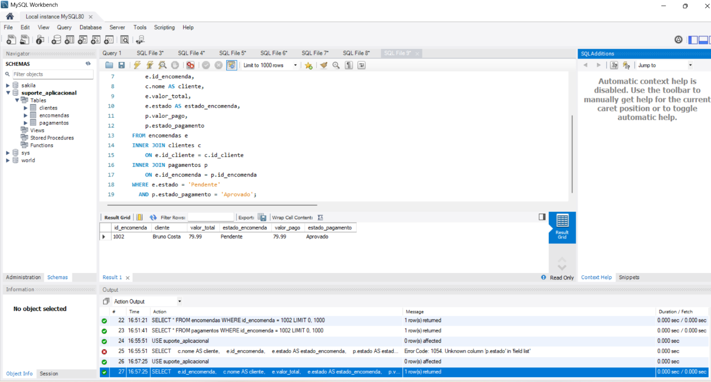
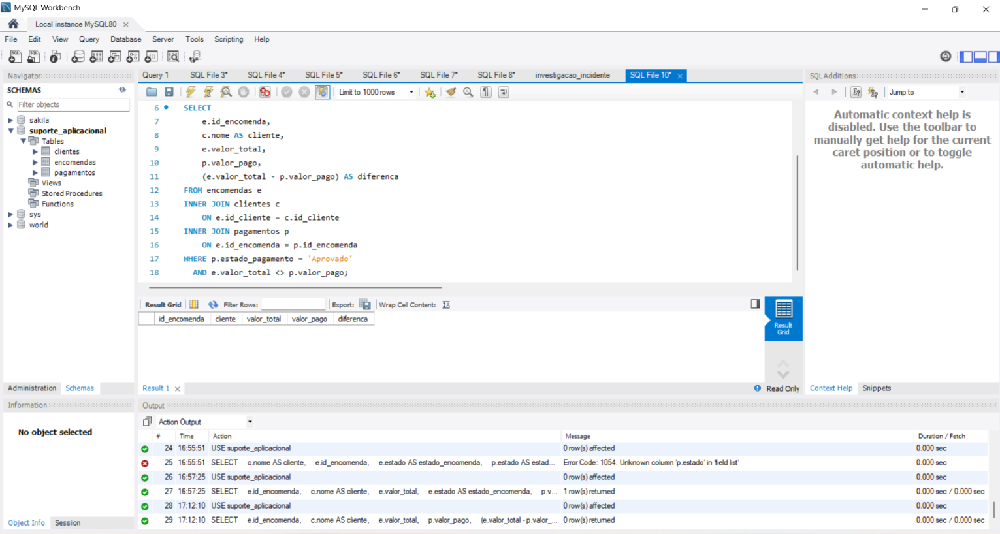
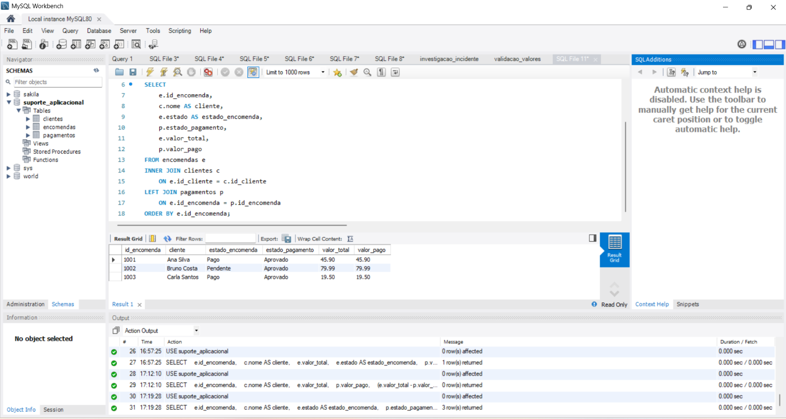
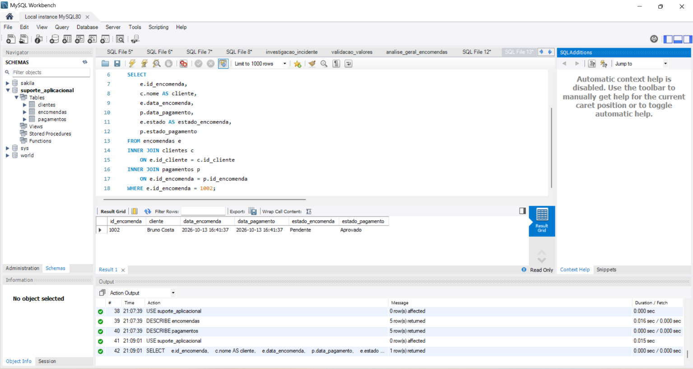
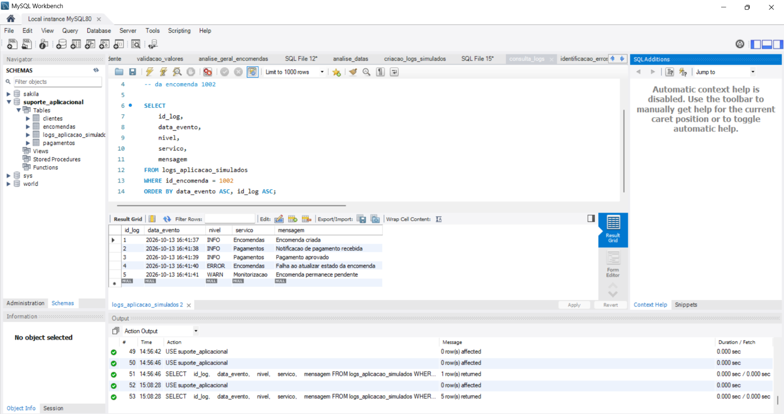
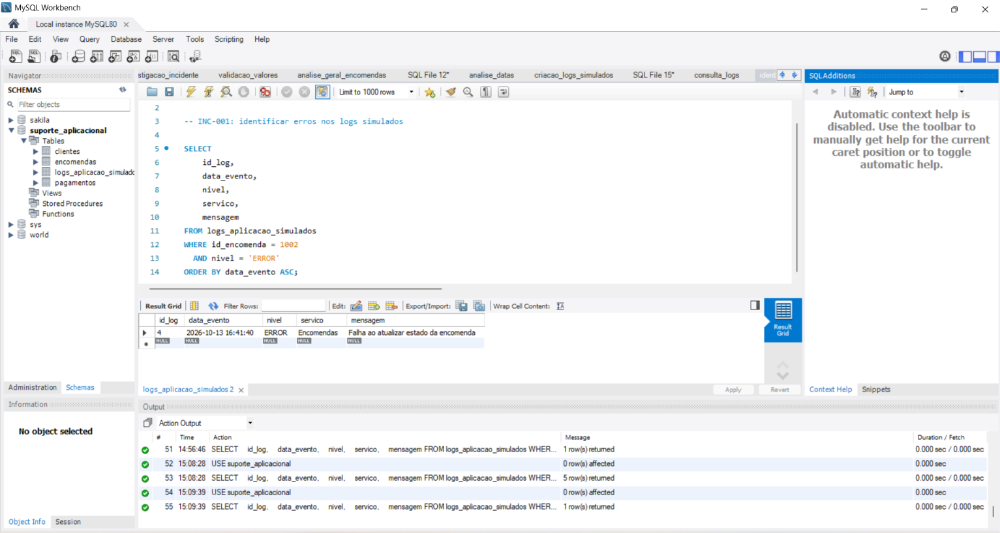
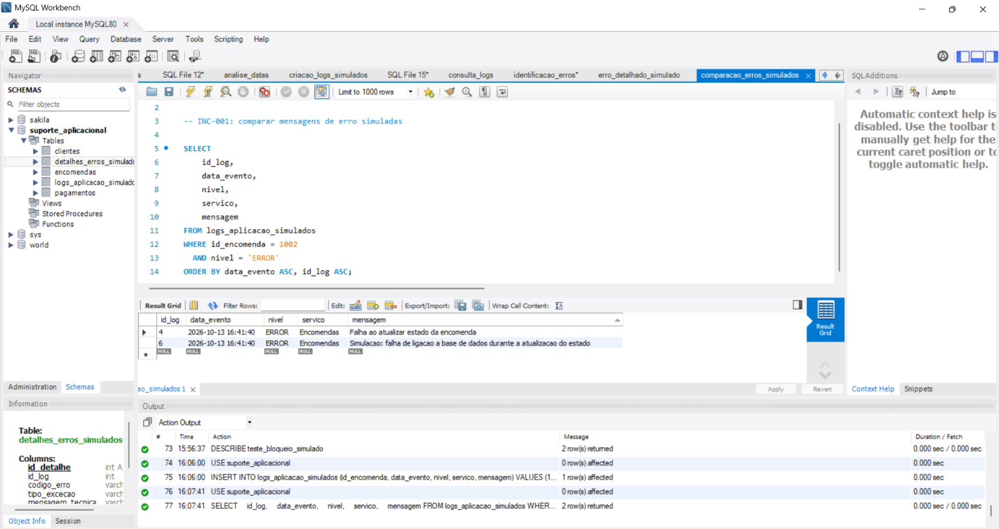

# INC-001 — Encomenda pendente com pagamento aprovado

**Projeto:** Application Support Portfolio  
**Categoria:** Suporte Aplicacional / Investigação SQL  
**Ambiente:** MySQL — Base de dados simulada  
**Estado:** Em investigação  
**Data:** 13/10/2026

---

## 1. Descrição do incidente

Foi identificada uma inconsistência na encomenda **1002**, associada ao cliente fictício **Bruno Costa**.

O pagamento de **79,99 €** encontra-se aprovado, mas a encomenda permanece com o estado **Pendente**.

### Dados do incidente

| Campo | Informação |
|---|---|
| ID do incidente | INC-001 |
| Encomenda | 1002 |
| Cliente | Bruno Costa |
| Valor da encomenda | 79,99 € |
| Valor pago | 79,99 € |
| Estado da encomenda | Pendente |
| Estado do pagamento | Aprovado |
| Estado do incidente | Em investigação |

---

## 2. Objetivo da investigação

Verificar a consistência entre os dados das encomendas e dos pagamentos, identificar outros possíveis registos afetados e recolher evidências para investigar a causa da inconsistência.

**Objetivos específicos:**

- Confirmar o estado da encomenda e do pagamento.
- Verificar se o valor pago corresponde ao valor da encomenda.
- Identificar outras encomendas potencialmente afetadas.
- Analisar a estrutura das tabelas envolvidas.
- Formular hipóteses sobre a possível causa do incidente.
- Documentar os resultados da investigação.

---

## 3. Procedimentos realizados

### 3.1. Consulta 1 — Verificação dos estados

Foi utilizada uma consulta SQL com `INNER JOIN` para relacionar as tabelas `clientes`, `encomendas` e `pagamentos`.

A consulta procurou encomendas pendentes com pagamentos aprovados.

**Resultado:**

Foi identificada a encomenda **1002**, com pagamento aprovado e estado pendente.

O valor do pagamento corresponde ao valor total da encomenda: **79,99 €**.

**Script:** [investigacao_incidente.sql](../investigacao_incidente.sql)

### 3.2. Consulta 2 — Validação dos valores

Foi executada uma consulta SQL para identificar pagamentos aprovados cujos valores fossem diferentes dos valores das respetivas encomendas.

**Resultado:**

A consulta devolveu **0 registos**.

Não foram identificadas divergências de valores nos registos analisados.

**Script:** [validacao_valores.sql](../validacao_valores.sql)

### 3.3. Consulta 3 — Análise geral das encomendas

Foi utilizada uma consulta com `LEFT JOIN` para analisar as encomendas e os respetivos pagamentos, incluindo a possibilidade de encomendas sem pagamentos associados.

**Resultado:**

Foram analisadas três encomendas.

| Encomenda | Cliente | Estado encomenda | Pagamento | Valor |
|---|---|---|---|---|
| 1001 | Ana Silva | Pago | Aprovado | 45,90 € |
| 1002 | Bruno Costa | Pendente | Aprovado | 79,99 € |
| 1003 | Carla Santos | Pago | Aprovado | 19,50 € |

Apenas a encomenda **1002** apresentou a inconsistência de estados identificada.

**Script:** [analise_geral_encomendas.sql](../analise_geral_encomendas.sql)

### 3.4. Consulta 4 — Análise da estrutura das tabelas

Foi utilizado o comando `DESCRIBE` para analisar a estrutura das tabelas `encomendas` e `pagamentos`.

Na tabela `encomendas`, foram identificados os seguintes campos:

- `id_encomenda`
- `id_cliente`
- `data_encomenda`
- `valor_total`
- `estado`

**Observações:**

- O campo `data_encomenda` regista a data e hora de criação da encomenda.
- O campo `estado` possui o valor predefinido `Pendente`.
- Não foi identificado um campo específico para registar a data da última atualização do estado.

A análise detalhada da tabela `pagamentos` permanece pendente de documentação.

### 3.5. Consulta 5 — Análise das datas

Foi realizada uma consulta SQL para comparar as
datas registadas da encomenda 1002 e do pagamento.

**Resultado:**

| Campo | Resultado |
|---|---|
| Encomenda | 1002 |
| Cliente | Bruno Costa |
| Data da encomenda | 13/10/2026 16:41:37 |
| Data do pagamento | 13/10/2026 16:41:37 |
| Estado da encomenda | Pendente |
| Estado do pagamento | Aprovado |

As duas datas registadas são idênticas.

Esta informação não comprova quando o pagamento
foi aprovado, nem permite identificar a causa
raiz da inconsistência.

**Script:** [analise_datas.sql](../analise_datas.sql)
---

## 4. Diagnóstico preliminar

A investigação confirmou uma divergência entre o estado da encomenda e o estado do pagamento.

O pagamento encontra-se aprovado, mas a encomenda continua pendente.

Os valores registados são coincidentes.

### Hipótese técnica

Uma possível causa é uma falha no processo responsável pela atualização do estado da encomenda após a aprovação do pagamento.

Esta hipótese ainda não foi confirmada.

Para identificar a causa raiz, seria necessário analisar informações adicionais, como:

- Logs da aplicação.
- Histórico de processamento dos pagamentos.
- Eventos de atualização de estados.
- Regras de negócio da aplicação.
- Possíveis erros na integração com o serviço de pagamentos.

**Conclusão preliminar:**

A inconsistência foi identificada e isolada nos dados simulados, mas a causa raiz permanece por determinar.

---

## 5. Próximas ações

- [x] Identificar a encomenda afetada.
- [x] Confirmar o estado do pagamento.
- [x] Comparar os valores da encomenda e do pagamento.
- [x] Analisar outras encomendas da base de dados.
- [x] Verificar a estrutura da tabela `encomendas`.
- [ ] Documentar a estrutura completa da tabela `pagamentos`.
- [ ] Verificar os dados temporais disponíveis.
- [ ] Investigar possíveis falhas no processamento.
- [ ] Identificar a causa raiz, caso existam evidências suficientes.
- [ ] Propor uma solução técnica.
- [ ] Validar os resultados da eventual correção.

---

## 6. Estado atual do incidente

**Estado:** Em investigação.

A inconsistência entre o estado da encomenda e o pagamento foi confirmada.

Não foram identificadas divergências de valores nos pagamentos aprovados analisados.

A causa raiz ainda não foi determinada.

**Nenhuma alteração foi realizada nos dados da base de dados.**

---

## 7. Evidências da investigação

### Evidência 01 — Diagnóstico inicial

Consulta SQL que identificou a encomenda 1002 com pagamento aprovado e estado pendente.

### Evidência 02 — Validação dos valores

Consulta SQL utilizada para verificar divergências entre os valores das encomendas e os pagamentos aprovados.

O resultado não apresentou registos com valores divergentes.

### Evidência 03 — Análise geral

Consulta SQL com `LEFT JOIN` para analisar as encomendas e os respetivos pagamentos.

Foram apresentados três registos, sendo identificada uma inconsistência de estados na encomenda 1002.

### Evidência 04 — Análise das datas

Consulta SQL que compara a data registada da
encomenda 1002 com a do respetivo pagamento.

As datas são idênticas, mas a encomenda
permanece pendente apesar do pagamento aprovado.

---

## 8. Competências técnicas demonstradas

- Investigação de incidentes de suporte aplicacional.
- Consultas SQL com `SELECT` e `WHERE`.
- Relacionamento de tabelas com `INNER JOIN`.
- Análise de dados com `LEFT JOIN`.
- Validação da consistência de dados.
- Análise da estrutura de tabelas com `DESCRIBE`.
- Identificação de inconsistências aplicacionais.
- Formulação de hipóteses técnicas.
- Documentação e recolha de evidências.
- Controlo de versões com GitHub.

---

## 9. Considerações finais

Este incidente faz parte de um projeto prático de simulação de atividades de Suporte Aplicacional.

A investigação permitiu aplicar consultas SQL para identificar inconsistências, validar informações e documentar evidências técnicas.

O diagnóstico inicial foi concluído, permanecendo pendente a identificação da causa raiz e a eventual resolução do incidente.

**Projeto desenvolvido com dados fictícios para fins de aprendizagem e demonstração de competências técnicas.**

---

## 10. Investigação complementar — Logs simulados

### 10.1. Objetivo

Simular a análise de logs de uma aplicação para
investigar uma possível falha na atualização
do estado da encomenda 1002.

Os eventos foram criados exclusivamente para
treino e não representam logs reais da aplicação.

### 10.2. Eventos analisados

Foram criados cinco eventos fictícios:

| Hora | Nível | Evento |
|---|---|---|
| 16:41:37 | INFO | Encomenda criada |
| 16:41:38 | INFO | Notificação recebida |
| 16:41:39 | INFO | Pagamento aprovado |
| 16:41:40 | ERROR | Falha na atualização |
| 16:41:41 | WARN | Encomenda permanece pendente |

### 10.3. Identificação do erro

Foi utilizada uma consulta SQL para filtrar
os eventos da encomenda 1002 classificados
com o nível ERROR.

**Resultado:**

- ID do log: 4
- Serviço: Encomendas
- Data: 13/10/2026 16:41:40
- Mensagem: Falha ao atualizar estado da encomenda

A mensagem identifica a operação que falhou
no cenário simulado, mas não revela a causa
técnica específica.

### 10.4. Scripts utilizados

- [Criação dos logs](../criacao_logs_simulados.sql)
- [Consulta cronológica](../consulta_logs.sql)
- [Identificação de erros](../identificacao_erros.sql)

### 10.5. Evidências visuais

**Evidência 05 — Consulta cronológica**

**Evidência 06 — Identificação do erro**

### 10.6. Conclusão

No cenário fictício, foi identificada uma
falha na atualização do estado da encomenda
após o registo de aprovação do pagamento.

Ainda não existem informações suficientes
para determinar a causa técnica dessa falha.

A simulação não comprova a causa raiz
da inconsistência observada na base original.

**Estado do INC-001: Em investigação.**

---

## 11. Encerramento técnico do exercício

### 11.1. Resultado da investigação

Foi confirmada uma inconsistência entre o estado
da encomenda 1002 e o estado do respetivo pagamento.

A encomenda permanece pendente, apesar de existir
um pagamento aprovado no valor de 79,99 €.

As consultas SQL permitiram verificar os estados,
comparar os valores e analisar as datas disponíveis.

### 11.2. Análise complementar dos erros simulados

Foram comparadas duas mensagens de erro fictícias:

- Log 4: falha ao atualizar estado da encomenda.
- Log 6: simulação de falha de ligação à base de dados.

A segunda mensagem apresenta uma hipótese técnica
mais específica, mas foi criada para treino e não
constitui prova de uma falha real.

**Scripts:**

- [Erro detalhado simulado](../erro_detalhado_simulado.sql)
- [Comparação dos erros](../comparacao_erros_simulados.sql)

**Evidência 07 — Comparação de erros:**

### 11.3. Limitações

Não foi possível determinar a causa raiz do
incidente original com os dados disponíveis.

Não foram realizadas alterações aos registos
originais das encomendas ou dos pagamentos.

### 11.4. Recomendações técnicas

Num ambiente real, as próximas ações seriam:

1. Consultar os logs reais da aplicação.
2. Verificar códigos de erro e exceções.
3. Analisar a integração com o serviço de pagamentos.
4. Confirmar as regras de atualização de estados.
5. Escalar o incidente para a equipa responsável.
6. Validar uma eventual correção autorizada.

### 11.5. Estado final do projeto

**Projeto de aprendizagem: Concluído.**

**Incidente INC-001: Não resolvido — causa raiz
não determinada.**

O exercício demonstrou competências de investigação
com SQL, análise de logs simulados, validação de
dados e documentação técnica.
